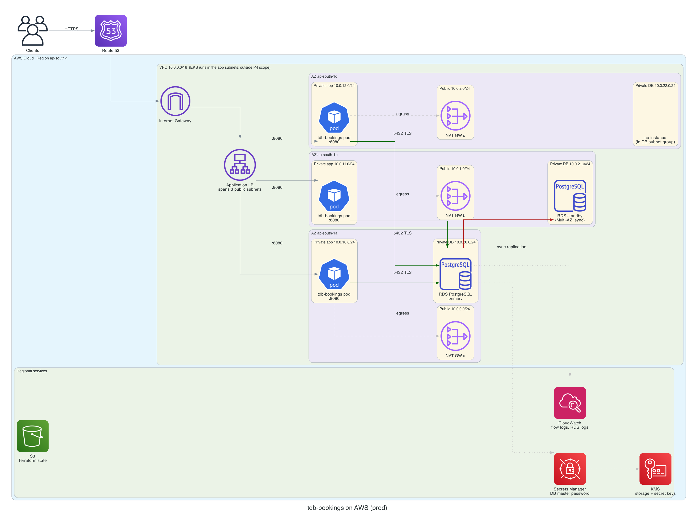

# tdb-devops-handson

A minimal bookings web service, and everything needed to run it in production: container image, CI/CD,
Helm chart, AWS Terraform, and SLO-based alerting with a runbook.

The service is deliberately small. The delivery around it is the point. Design and decisions for every part are in
[`docs/PLAN.md`](docs/PLAN.md). Rules for contributors and AI agents are in [`AGENTS.md`](AGENTS.md).



Architecture, network flow, data flow and CI/CD diagrams: [`docs/architecture/`](docs/architecture/README.md).

## Service

Python 3.13, FastAPI.

| Endpoint | Response |
|---|---|
| `GET /health` | `200 {"status":"ok"}`. Liveness only; does not touch the database. |
| `GET /bookings` | `200 {"items":[…],"count":3}`. Sample bookings. |
| `GET /docs` | OpenAPI UI generated from the code. |

### Configuration

All configuration comes from environment variables. The same build runs in every environment.

| Variable | Default | Notes |
|---|---|---|
| `PORT` | `8080` | HTTP port. |
| `HOST` | `0.0.0.0` | Bind address. |
| `APP_ENV` | `local` | Environment name. |
| `LOG_LEVEL` | `info` | Uvicorn log level. |
| `DATABASE_URL` | unset | PostgreSQL URL. Treated as a secret: never logged. Comes from a Kubernetes Secret / AWS Secrets Manager outside local runs. |

### Run locally

Requires [uv](https://docs.astral.sh/uv/).

```bash
uv sync --locked
PORT=8080 uv run python -m app.main
curl -s localhost:8080/health      # {"status":"ok"}
curl -s localhost:8080/bookings
```

### Checks

```bash
make check     # ruff lint + format check, mypy --strict, pytest
```

## Delivery

| Problem | Branch | What it adds |
|---|---|---|
| P1 Container image | `feature/p1-container-image` | `Dockerfile` |
| P2 CI pipeline | `feature/p2-ci-pipeline` | `.github/workflows/ci.yaml` |
| P3 Helm chart | `feature/p3-helm-chart` | `charts/tdb-bookings/` |
| P4 Terraform for AWS | `feature/p4-terraform-aws` | `infra/terraform/` |
| P5 Alerts and runbook | `feature/p5-alerts-runbook` | `monitoring/`, `docs/runbooks/` |

Each problem is one branch, one PR (using [the template](.github/pull_request_template.md)), one review and one
merge into `main`, in order. Sections below are filled in as each PR lands.

## P1: Container image

```bash
make docker-build                    # docker build -t tdb-bookings:local .
make docker-run PORT=9000            # read-only root fs, no capabilities, no-new-privileges
curl -s localhost:9000/health        # {"status":"ok"}
docker inspect --format '{{.Config.User}} {{.State.Health.Status}}' <container>   # 10001:10001 healthy
```

- Multi-stage build on `python:3.13-slim`, pinned by digest. Final image: **228 MB uncompressed / 49 MB compressed**
  (202 MB is the base; app dependencies 19.5 MB).
- Runs as UID/GID `10001`. pip, uv and compilers are not in the final image.
- `HEALTHCHECK` uses the image's own Python, so no curl is added.
- The same image runs everywhere: `PORT`, `APP_ENV`, `DATABASE_URL`, … come from the environment at run time.
- Why this base image: [`docs/adr/0001-container-base-image.md`](docs/adr/0001-container-base-image.md).
