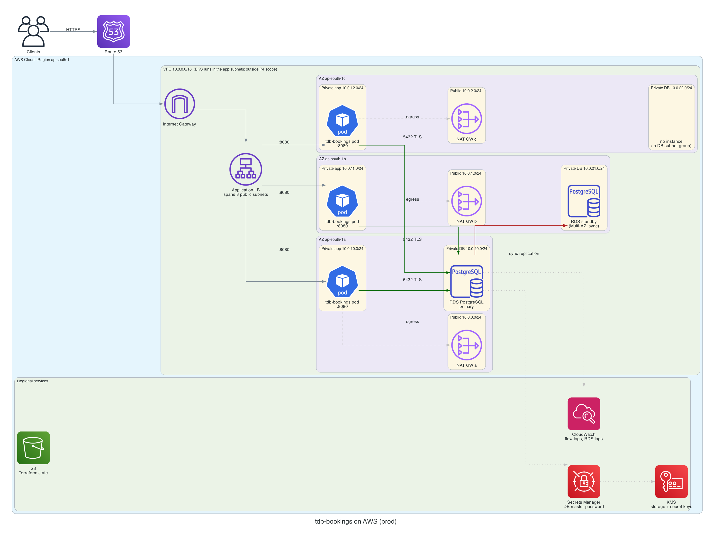
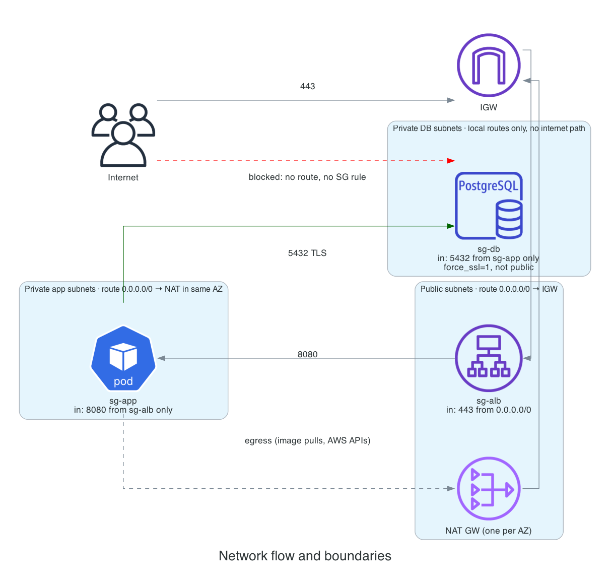
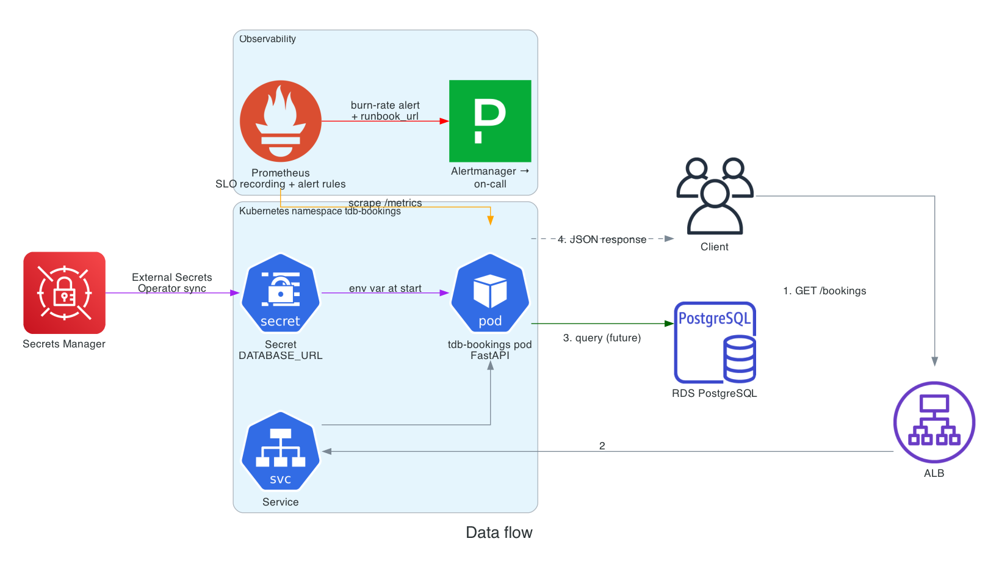
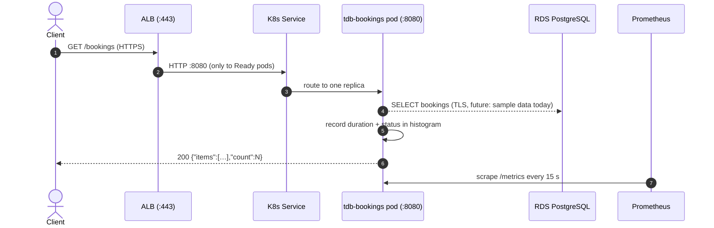
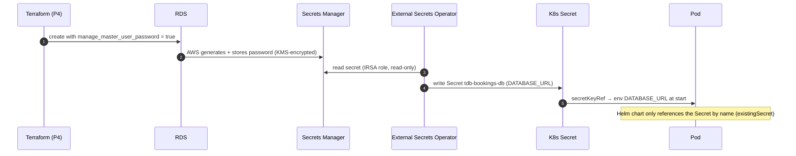
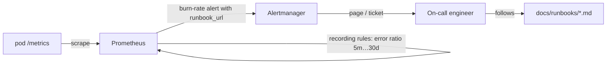
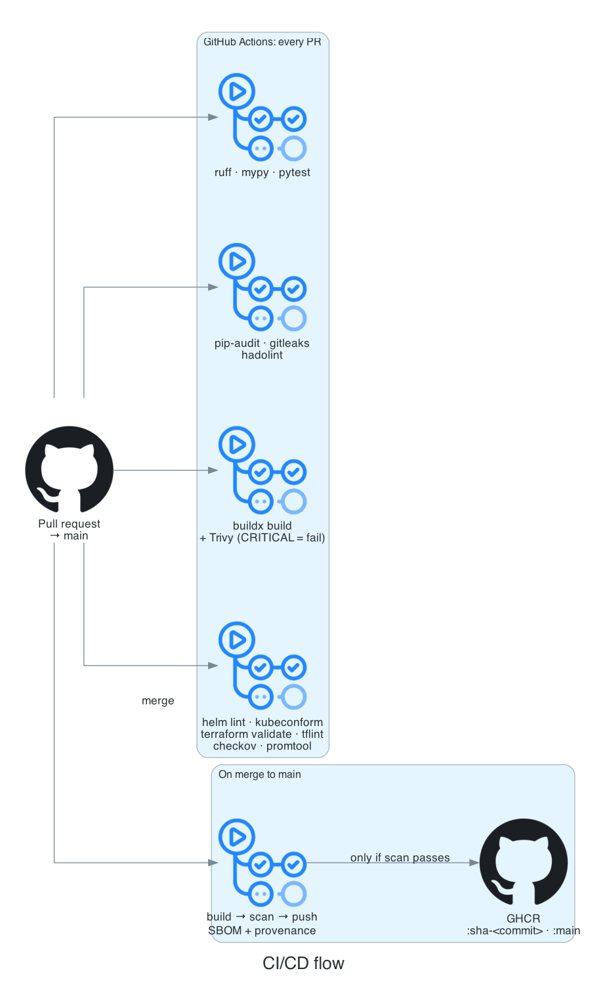

# Architecture

Diagrams are code: [`generate_diagrams.py`](generate_diagrams.py) draws them with the official AWS and Kubernetes
icons. Edit the script, not the PNGs:

```bash
brew install graphviz                       # once
cd docs/architecture && uv run --no-project --with diagrams python generate_diagrams.py
```

Scope note: P4 provisions the **network and PostgreSQL** only. The Kubernetes cluster (EKS), the load balancer and
External Secrets Operator are the platform the Helm chart (P3) deploys onto. They are drawn so the picture is complete
and marked as outside P4.

## 1. AWS deployment (prod)



| Layer | Prod | Dev |
|---|---|---|
| Region / AZs | ap-south-1, 3 AZs | ap-south-1, 2 AZs |
| Subnet tiers per AZ | public, private-app, private-db | same |
| NAT gateways | one per AZ (an AZ outage never cuts egress for the others) | one shared (cost) |
| PostgreSQL | RDS Multi-AZ: synchronous standby in a second AZ, automatic failover | single AZ |
| Secrets | DB master password generated and stored by Secrets Manager, KMS-encrypted | same |
| Terraform state | S3, versioned, encrypted, native lock file | same bucket, separate key |

**Losing one AZ in prod:** the ALB stops routing to that AZ, the other AZs' pods keep serving (topology spread
+ PDB keep at least 2 running), each surviving AZ still has its own NAT, and if the AZ held the RDS primary, RDS
promotes the standby and the DNS endpoint follows it (typically 60–120 s).

## 2. Network flow and boundaries



| From | To | Port | Allowed by |
|---|---|---|---|
| Internet | ALB | 443 | `sg-alb` ingress 0.0.0.0/0, public subnets route to IGW |
| ALB | pods | 8080 | `sg-app` ingress from `sg-alb` only |
| pods | RDS | 5432 (TLS required) | `sg-db` ingress from `sg-app` only; `rds.force_ssl = 1` |
| pods | Internet (image pulls, AWS APIs) | 443 | private-app route `0.0.0.0/0 → NAT` in the same AZ |
| Internet | RDS | any | **Blocked.** DB subnets have no internet route, `publicly_accessible = false`, no SG rule |
| RDS | Internet | any | **Blocked.** No route out of the DB subnets |

## 3. Data flow



### Request path



### Secret delivery path (no secret value ever in git)



### Alert path



## 4. CI/CD flow



Every PR runs all checks. On merge to `main`, the image is built, scanned, and only pushed to GHCR if Trivy finds no
CRITICAL vulnerability. Tag `sha-<full commit sha>` plus the OCI `revision` label and a signed build-provenance
attestation tie every image to the exact commit.
